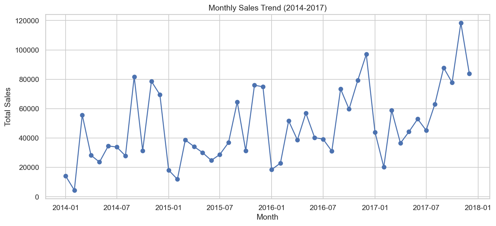
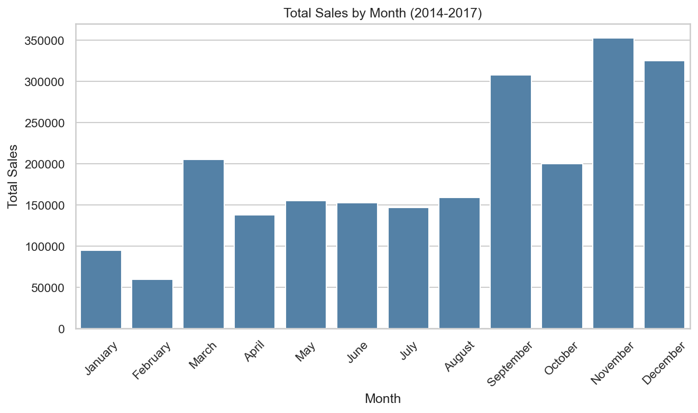
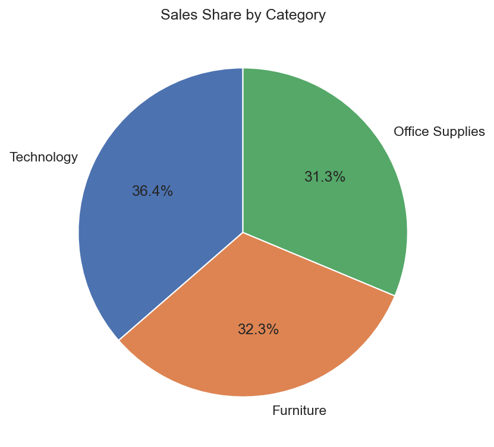
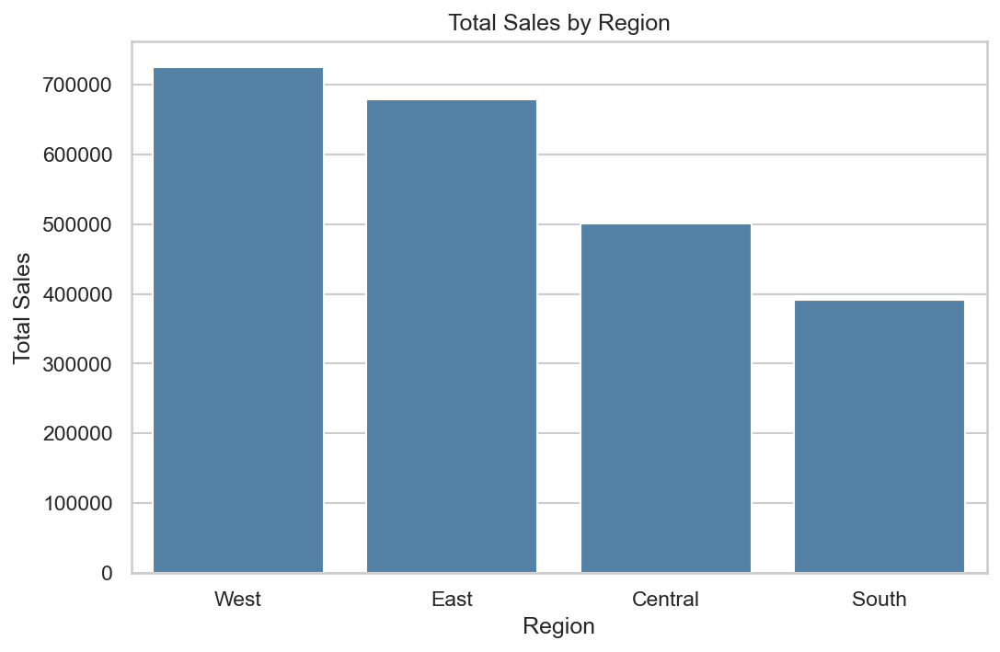
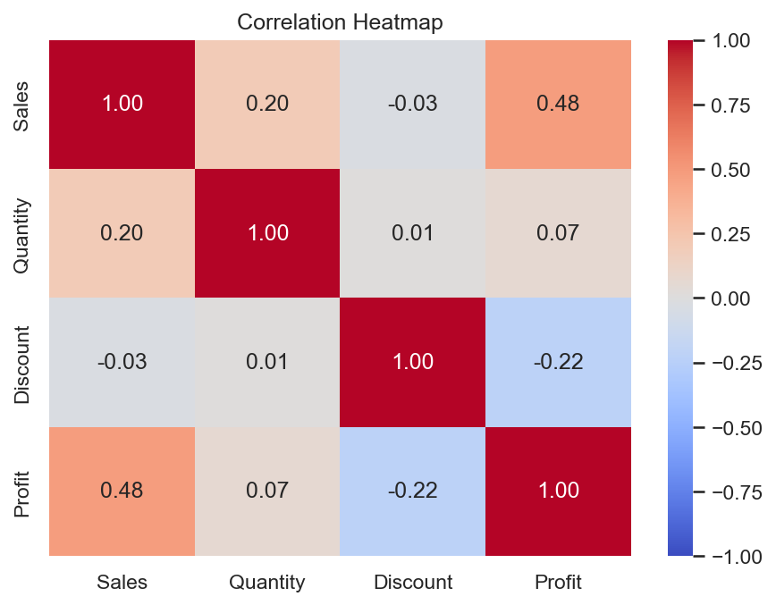

# E-Commerce Sales & Customer Behavior Analysis

Exploratory data analysis of the Superstore sales dataset (2014-2017) using Python. The goal was to answer common business questions about sales, products, customers and regions.

## Dataset
- Source: Superstore Dataset on Kaggle (9,994 rows, 21 columns)
- Covers orders from the United States, so location analysis is done by region and state

## Business Questions
- How much were the sales each month?
- Which products sell the most (by sales and by quantity)?
- Which category generates the most revenue?
- Which customers spend the most?
- Which regions and states bring in the most revenue?
- Which months are the peak sales months?
- What is the average order value?

## Tools Used
Python, Pandas, NumPy, Matplotlib, Seaborn, Jupyter Notebook

## Project Structure
```
ecommerce-sales-analysis/
├── data/
│   ├── raw/          # original dataset
│   └── cleaned/      # cleaned dataset
├── notebooks/
│   └── analysis.ipynb
├── images/           # saved charts
└── README.md
```

## Steps Followed
1. Loaded the data and checked structure, missing values and duplicates
2. Converted date columns to datetime
3. Created Year, Month, Month Name and Quarter columns
4. Analyzed sales, products, category, customers, region, orders and correlations
5. Visualized the results and wrote down the findings

## Key Findings
- Sales grow over the four years. September, November and December are the peak months, and January and February are the weakest.
- Technology brings the most revenue (36.4%), followed by Furniture (32.3%) and Office Supplies (31.3%).
- The West (31.6%) and East (29.5%) regions together give about 61% of sales. California and New York lead among states.
- The top 10 customers make up only about 7% of total sales, so revenue is spread across many customers.
- Average order value is about 459, but the median is only about 152, because a few very large orders pull the average up.
- Quantity and sales have only a weak correlation (0.20). The products sold in the highest quantities (staples, binders) are cheap and do not appear in the top 10 by sales.

## Charts







## Limitations
- Only US data is available, so there is no country-level comparison.
- Low-selling products were checked by total sales and order count, not year by year.

## How to Run
1. Clone the repository
2. Install the libraries: 'pip install -r requirements.txt'
3. Open `notebooks/analysis.ipynb` and run all cells